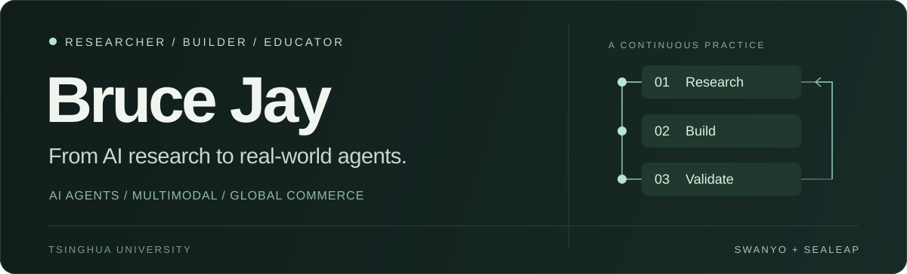
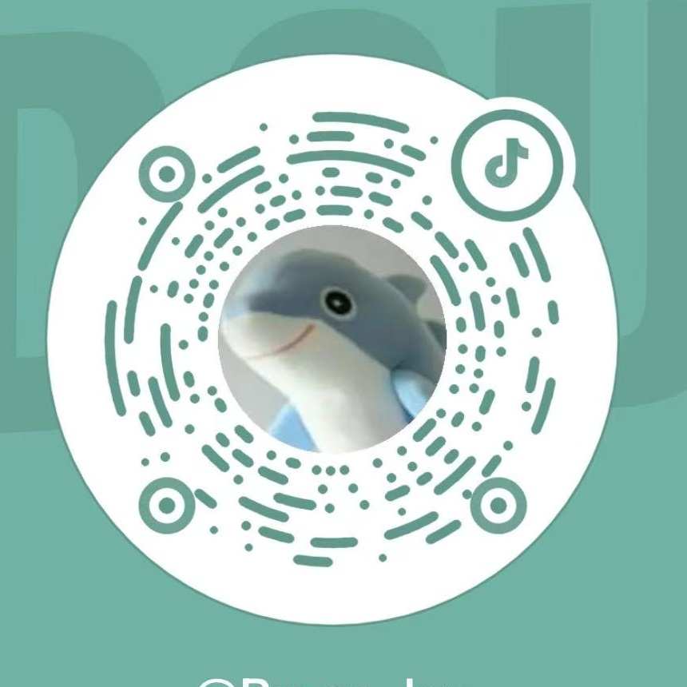

  

  <a href="https://sealeap.cn">SeaLeap 社区 ↗</a> &nbsp; / &nbsp;
  <a href="https://mcp.swanyo.com">Swanyo MCP ↗</a> &nbsp; / &nbsp;
  <a href="#联系我--connect">联系与社媒 ↓</a>

## 你好，我是 Bruce Jay

**清华大学人工智能硕士 · AI 研究者 · 跨境电商创业者 · 亚马逊广告卖家讲师**

我关注多模态生成与 Agent 系统，也在自营跨境业务和企业项目中检验这些方法。正在通过 **质递归科技、Swanyo 与 SeaLeap**，把算法研究、产品工程与一线经营连接起来。

把研究做成产品，把实践沉淀为可复用的能力。

- **研究经历** — 曾在字节跳动、阿里国际、腾讯混元从事大模型算法相关研究；以第一作者身份发表多篇 AI 国际顶会论文，并担任相关期刊与会议审稿人。
- **业务实践** — 围绕选品、Listing、广告、库存与经营，构建有业务依据、可复核、可持续迭代的 Agent 工作流。
- **知识分享** — 亚马逊官方认证的广告卖家讲师；分享 AI 与跨境电商实践，提供企业 Agent 内训、定制与转型陪跑。

 

## 正在构建 / Building

<table>
  <tr>
    <td width="50%" valign="top">
      01 / PRODUCTS
      <h3>Swanyo · 企业 Agent</h3>
      
让 Agent 进入真实经营流程，连接数据读取、问题诊断、方案、人工确认、执行回读与复盘。

      
<strong>Swanyo MCP</strong> 为企业已有的 Agent 提供统一的数据与工具接入入口。

      <a href="https://mcp.swanyo.com">了解 Swanyo MCP ↗</a>
        
    </td>
    <td width="50%" valign="top">
      02 / COMMUNITY &amp; OPEN SOURCE
      <h3>SeaLeap · 海跃社区</h3>
      
为拥抱 AI 与 Agent 的跨境卖家而建，分享真实经验，持续整理可复用的经营方法与 Skills。

      
从亚马逊运营、多平台电商，到电商品牌与界面设计。

      <a href="https://sealeap.cn">进入 SeaLeap 社区 ↗</a>
        
    </td>
  </tr>
</table>

## 开源与研究 / Selected work

| 项目 | 我在探索的方向 |
| :--- | :--- |
| **[SeaLeap Amazon Skills](https://github.com/xjli360/sealeap-amazon-skills)** | 将亚马逊选品、Listing、广告、库存与经营知识，整理为可复用的 Agent 工作流。 |
| **[SeaLeap eCommerce Skills](https://github.com/xjli360/sealeap-ecommerce-skills)** | 覆盖 Shopify、Etsy、eBay、TikTok Shop、Walmart、Mercado Libre、OZON 与 Wayfair 的运营实践。 |
| **[eCommerce Design Systems](https://github.com/xjli360/awesome-design-md-ecommerce)** | 为 AI 构建电商网站提供品牌与界面设计参考，让视觉语言可以被理解和复用。 |
| **[SoulDance](https://github.com/xjli360/SoulDance-Official)** · ICCV 2025 | 音乐对齐的整体 3D 舞蹈生成，探索身体、手部与面部动作的协调建模。[论文 ↗](https://arxiv.org/abs/2507.14915) |
| **[VisCtrl](https://github.com/xjli360/VisCtrl)** | 通过迭代式自注意力控制，实现无需额外训练的视觉定制。[论文 ↗](https://arxiv.org/abs/2406.06258) |

 

## 联系我 / Connect

欢迎交流 **Agent 产品与工程、跨境电商合作、企业内训与定制、开源及研究**。三个平台同号：**`BruceJay618`**。

<table>
  <tr>
    <td width="33%" align="center">
       
      
      
<strong>微信</strong> WECHAT

      
<code>BruceJay618</code>

      <a href="assets/wechat-qr.jpg">扫码联系 ↗</a>
        
    </td>
    <td width="33%" align="center">
       
      
      
<strong>抖音</strong> DOUYIN

      
<code>BruceJay618</code>

      <a href="https://www.douyin.com/search/BruceJay618?type=user">搜索抖音号 ↗</a>
        
    </td>
    <td width="33%" align="center">
       
      
      
<strong>小红书</strong> XIAOHONGSHU

      
<code>BruceJay618</code>

      <a href="https://www.xiaohongshu.com/user/profile/6790765a000000000d00bed1">查看主页 ↗</a>
        
    </td>
  </tr>
</table>

  
展开二维码 · 微信 / 抖音 / 小红书

   
  <table>
    <tr>
      <td align="center"> <strong>微信</strong></td>
      <td align="center"> <strong>抖音</strong></td>
      <td align="center"> <strong>小红书</strong></td>
    </tr>
  </table>
  
使用对应 App 扫码；也可以直接搜索上方账号。

 

---

RESEARCH → BUILD → VALIDATE → SHARE 让 Agent 成为真实业务中的长期能力。

